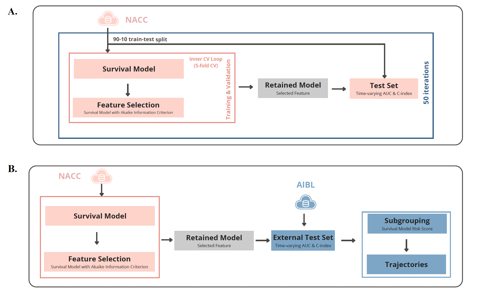
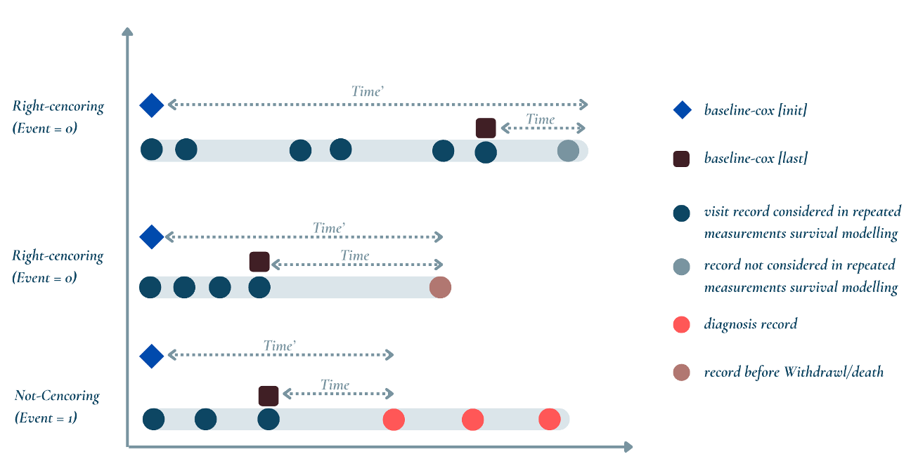

# Using a Survival Analysis Model with Repeated Measurements to Predict Risk of Alzheimer’s Disease

This is the official repository accompanying the paper **Using a Survival Analysis Model with Repeated Measurements to Predict Risk of Alzheimer’s Disease**.

**Authors:** Yihan Wang, Benjamin Goudey, Xinran Cui, Shu Liu, Colin L. Masters, Liang Jin, Yijun Pan; for the AIBL Research Group

## Overview

We use longitudinal data from the National Alzheimer's Coordinating Center (NACC) and the Australian Imaging, Biomarkers and Lifestyle (AIBL) study to ask whether **repeated clinical measurements improve prediction of future progression** compared with the most recent visit alone. All models predict from the same time point, **month 48 after each participant's first visit (the landmark)**, for the same participants, so the comparison is fair. Two endpoints are analysed separately:

| Endpoint | Population at baseline | Event |
|---|---|---|
| AD | Cognitively unimpaired (CU) or MCI | First recorded dementia (NACC `NACCUDSD=4`, all-cause dementia; AIBL AD diagnosis) |
| MCI | CU | First recorded MCI (dementia without prior MCI is censored: net MCI risk) |

NACC is used for model development and internal validation (3 outer folds); AIBL is a locked external validation cohort.

## Research question

**Primary:** Among people still event-free at month 48, does information from earlier visits improve prediction of future progression compared with the latest visit alone? The primary contrast is the **latest 3 visits vs the latest 1 visit**, within each model.

**Secondary:**
1. History quantity: latest 1, 2, 3 and all visits up to month 48 (visits selected backward from the landmark).
2. Recency: first visit vs latest visit, both predicting from month 48.
3. History representation: summary features (Landmark Cox, DeepSurv) or the ordered visit sequence with each participant's own irregular visit times (Dynamic-DeepHit).
4. Exploratory: higher- vs lower-risk groups at a locked development threshold.

```
first usable visit (month 0)                  landmark (month 48)
  v1 ──── v2 ──── v3 ──── … ──── vn    │   ──── predict event within 24, 36, 60 months ────▶
  └── predictors: visits at or before month 48 ┘
Inclusion: event-free at month 48, ≥3 visits by month 48, follow-up beyond month 48
```

## Features

| Type | Variables | Timing |
|---|---|---|
| Baseline (4) | Age, sex, years of education, APOE4 carrier status | First visit |
| Repeated (13) | CDR Sum of Boxes, MMSE, GDS, logical memory immediate and delayed recall, digit span forward and backward, animal fluency, Boston Naming Test, BMI, systolic and diastolic blood pressure, heart rate | Every visit up to month 48 |

## Models

| Model | File | How visit history is used | Visit timing | History conditions |
|---|---|---|---|---|
| Landmark Cox (ridge) | `02_python_models_{AD,MCI}.ipynb` | Latest value, slope per year, mean − latest, months since last visit | Partly | first visit, latest 1, 2, 3, all; baseline features only |
| DeepSurv | `02_python_models_{AD,MCI}.ipynb` | Same inputs as Landmark Cox (non-linear) | Partly | first visit, latest 1, 2, 3, all |
| Dynamic-DeepHit (landmark adaptation) | `02_python_models_{AD,MCI}.ipynb` | Ordered visit sequence with gaps and time to month 48 | Fully | first visit, latest 1, 2, 3, all |

A no-covariate Kaplan–Meier model is added in the evaluation as the standard reference for the integrated Brier score (chance, AUC = 0.5, is the reference for AUC).

Every model writes `predictions.csv` in one common format (predicted event-free probability at 24–60 months after the landmark, for the same participants and folds), and `04_evaluate_and_plot.ipynb` scores all of them with identical code.

## Assessment

| Criterion | Detail |
|---|---|
| **Primary:** integrated Brier score | Months 24–60 after the landmark (lower is better) |
| Time-dependent AUC and Brier score | 24, 36 and 60 months after the landmark; AUC also as a curve over 24–60 months |
| Calibration (supplementary) | Predicted vs Kaplan–Meier observed risk at 60 months |
| Uncertainty | 200 paired participant bootstrap resamples (same resamples for all models) |
| Risk groups | High vs low risk at the median predicted 60-month risk of the training set (locked for AIBL) |
| Relative change in IBS (Table 3) | % change in IBS versus the comparator, bootstrapped as a ratio |
| Feature importance (supplementary) | Permutation importance on held-out NACC folds (latest 3 visits): drop in AUC at 60 months and increase in IBS when one feature group is shuffled; identical for all three Python models |

## Preprocessing

The variable harmonisation is defined in the two preprocessing notebooks of the published ADRS analysis:

| File | Defines | Run in the current pipeline? |
|---|---|---|
| `preprocessing(AIBL+NACC) simplify.ipynb` | AD endpoint: variable mapping between NACC and AIBL (`raw_data/naming_convension.xlsx`), NACC missing codes, APOE4 coding, digit-span rescaling, AIBL education and APOE filling | No: reference only |
| `preprocessing(AIBL+NACC) simplify MCI.ipynb` | Same harmonisation for the MCI endpoint | No: reference only |

Step 1 (`prepare_history_information.py`, called by `01_prepare_inputs.ipynb`) applies exactly this harmonisation to the raw files, and corrects the outcome construction:
- Diagnosis dates are taken from all diagnosis records **before** rows with missing predictors are removed, so a dropped visit cannot hide a diagnosis.
- Eligibility uses only information available at month 48 (at least 3 visits by month 48). The earlier rules that depended on future visits (more than 3 visits in total; removing the second-to-last visit when the last two are less than 6 months apart) are not used.

Step 1 checks that the code in the two preprocessing notebooks has not changed since its harmonisation was copied. If you edit them, step 1 stops and asks for `prepare_history_information.py` to be updated. Running the notebooks themselves only regenerates `preprocessed_data/`, which the current pipeline does not use.


## How to run

Run from `code/`, in order:

| Step | File | Language | Time |
|---|---|---|---|
| 1 | `01_prepare_inputs.ipynb` (uses the harmonisation above) | Python | minutes |
| 2 | `02_python_models_AD.ipynb`, `02_python_models_MCI.ipynb` | Python | ~5–30 min each |
| 3 | `04_evaluate_and_plot.ipynb` (named 04: step 03 was the joint model, now dropped) | Python | ~10 min |

Each step verifies internally that it uses the same participants, folds and input data as step 1 (and stops otherwise).

### Smoke test (execution check)

`code/checks/smoke_test.py` checks that the whole pipeline runs, without touching the real results. It exports small "smoke" inputs (2 folds), runs the validation scripts, then executes copies of the 02 and 04 notebooks with very short training. Everything is written to `results/smoke/` and `plots/smoke/` (figures stamped "execution check only"); the numbers must not be reported. Run it after changing code, before the long runs:

```bash
python code/checks/smoke_test.py            # ~5 min
python code/checks/smoke_test.py --only python evaluate
```

Helper code: `landmark_common.py` (study settings, paths, cohort, metrics), `landmark_evaluation.py` (scoring, tables, figures), `export_landmark_inputs.py` (step 1), `prepare_history_information.py` (endpoint construction from raw data). Checks (`checks/`): `smoke_test.py`, `validate_history_information.py`, `validate_history_models.py`, and the archived joint model in `checks/joint_model/`.

## Outputs

```
results/
  preprocessing/{AD,MCI}/        endpoint-safe longitudinal data and audits (step 1)
  AD/  (same layout for MCI)
    inputs/                      cohort, folds, visits ≤ month 48, development history, cohort summary
    Cox_ridge/                   predictions.csv, feature_importance.csv, tuning.json, run_info.json
    DeepSurv/
    DynamicDeepHit/
    evaluation/                  Table1_cohort_characteristics.csv, TableS1_participant_flow.csv,
                                 Table2_performance_by_model_and_history.csv (with n and events),
                                 Table3_paired_differences.csv (with % change in IBS), primary_3_vs_1_visits.csv,
                                 metrics_with_95CI.csv, paired_*_differences.csv, feature_importance_summary.csv,
                                 calibration_groups.csv, risk_group_*.csv
  smoke/                         smoke-test outputs (same layout; execution check only, never report);
                                 test_runs/ holds the executed notebook copies and logs
plots/
  AD/  (same layout for MCI)
    Main
    Figure1_participant_flow          participant flow from the source data to the month-48 cohort
    Figure2_performance_by_history    IBS and AUC-60 by visit history, all models
                                      (first visit = init, latest 1 = last, all prior = aggregated;
                                       reference lines: chance, no-covariate model)
    Figure3_risk_groups               Kaplan–Meier by predicted-risk group with numbers at risk, per model
    Supplementary
    FigureS1_three_vs_one_visits      latest 3 minus latest 1 visit (primary contrast), per model
    FigureS2_model_comparison         each model minus Landmark Cox (latest 3 = reference line at 0)
    FigureS3_auc_over_time            AUC over 24–60 months
    FigureS4_calibration              calibration at 60 months, per model
    FigureS5_risk_distribution        predicted-risk distributions
    FigureS6_feature_importance       permutation feature importance, per model
```

Each figure is saved as PNG (400 dpi) and PDF. Re-running a step overwrites its outputs.

## Repository structure

- `code/`
  - `preprocessing(AIBL+NACC) simplify.ipynb`, `preprocessing(AIBL+NACC) simplify MCI.ipynb`: harmonisation reference (see *Preprocessing*; not run).
  - `01_…` to `04_…`: the pipeline (see *How to run*), with helper files `landmark_common.py`, `landmark_evaluation.py`, `export_landmark_inputs.py`, `prepare_history_information.py`, `requirements.txt`.
  - `checks/`: smoke test of the whole pipeline and validation scripts (see *Smoke test*); `checks/joint_model/`: the archived joint model (`03_joint_model_{AD,MCI}.Rmd`, `r_landmark_models.R`; see *Models*).
  - `not used/`: the published ADRS model code (`model_performance_{AD,MCI}.Rmd`, `time-varying-utility.R`), its landmark version (`03_time_varying_cox_{AD,MCI}.Rmd`) and superseded benchmark notebooks.
- `results/`, `plots/`: outputs as above; `not_used/` subfolders hold earlier outputs.
- `manuscript/`: manuscript, supplementary material and figures.
- `raw_data/`: NACC and AIBL source files (local only, not shared; see below).
- `preprocessed_data/`: outputs of the published preprocessing notebooks (local only; not used by the current pipeline).

Original ADRS pipeline and censoring illustration (published paper):




## Environment

- Python 3.11: `code/requirements.txt` (PyTorch, pycox, lifelines, scikit-survival, scikit-learn, pandas, matplotlib, nbformat, nbclient).
- R is not needed for the current pipeline. The archived joint model (`code/checks/joint_model/`) and the code in `code/not used/` use R ≥ 4.3 (tested with 4.5.2) with `survival`, `nlme`, `JMbayes2` (≥ 0.6), `ggplot2`, `rmarkdown`, `jsonlite`.

## Data Sharing Statement

This repository contains code, figures and aggregated results only. `.gitignore` excludes the source data (`raw_data/`, `preprocessed_data/`) and every participant-level output (step-1 inputs, predictions, tuning files with participant IDs, risk-group assignments, smoke-test outputs). Notebooks are committed without outputs that show participant rows.

The data used in this study are derived from the Australian Imaging, Biomarkers, and Lifestyle (AIBL) dataset and the National Alzheimer's Coordinating Center (NACC), which are subject to specific access conditions. Due to these restrictions, we are unable to share the data directly.
